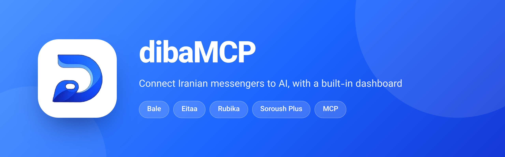
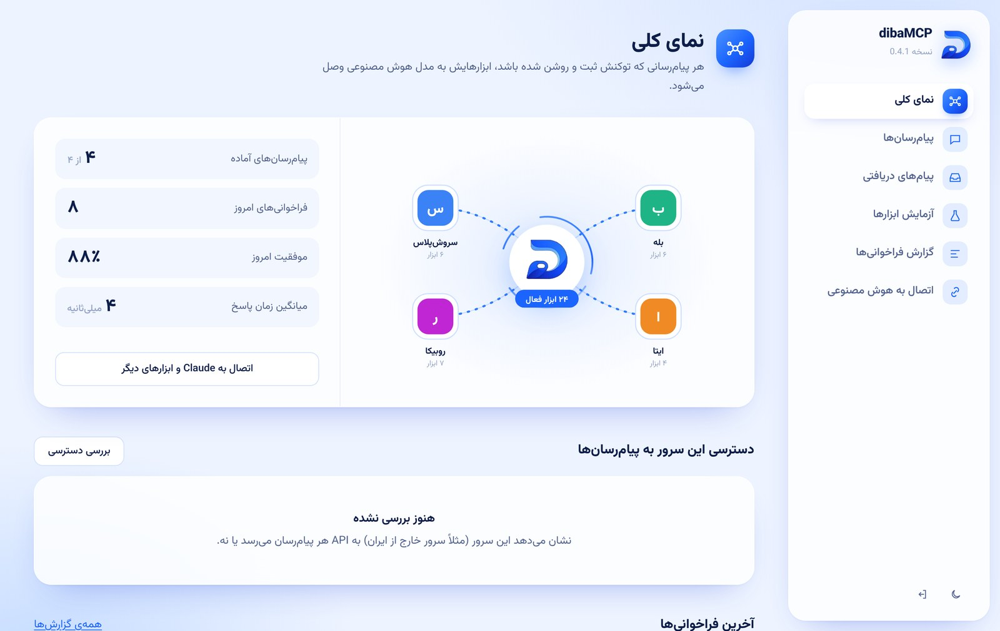
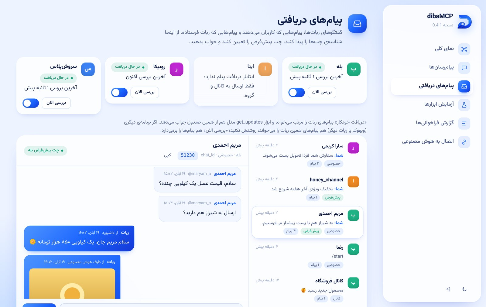
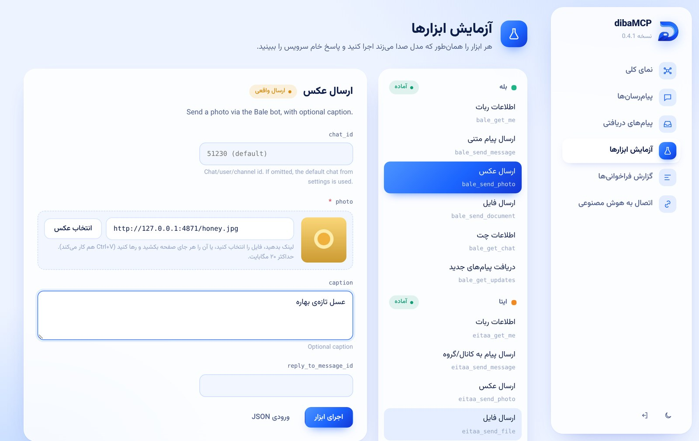
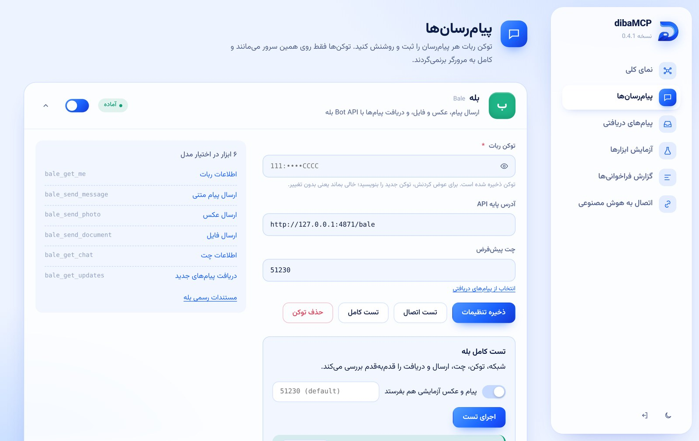
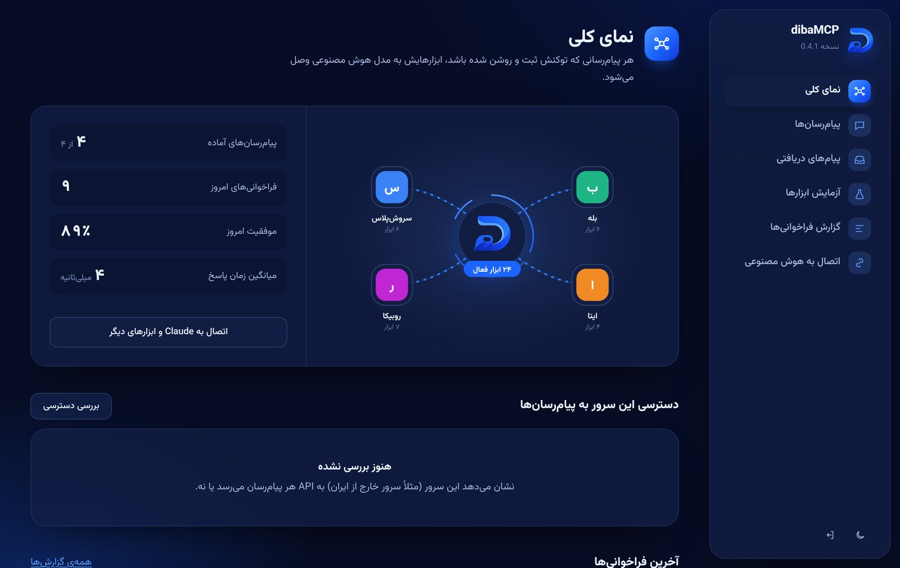

<p align="center">
  
</p>

<p align="center">
  <a href="README.md">English</a> · <b>فارسی</b>
</p>

<div dir="rtl">

**dibaMCP** یک سرور [MCP](https://modelcontextprotocol.io) است که به Claude، Cursor و هر کلاینت MCP دیگری اجازه می‌دهد در پیام‌رسان‌های ایرانی پیام بفرستد و پیام‌ها را بخواند. یک داشبورد فارسی هم دارد برای مدیریت ربات‌ها، آزمایش ابزارها و دیدن گفتگوها.

<p align="center">
  
</p>

## امکانات

| | |
|---|---|
| **چهار پیام‌رسان** | بله، ایتا، روبیکا و سروش‌پلاس: متن، عکس، فایل و موقعیت |
| **پیام‌های دریافتی** | پیام‌های ورودی و خروجی هر چت، پیدا کردن `chat_id` با یک کلیک، جواب سریع |
| **ارسال رسانه** | با لینک، با `file_id`، یا با کشیدن فایل در داشبورد |
| **تست کامل** | شبکه، توکن، چت، ارسال و دریافت قدم‌به‌قدم، با راهنما برای هر خطا |
| **سرور خارج از ایران** | پراکسی SOCKS5 و HTTP، و بررسی دسترسی به هر API |
| **دو روش اتصال** | Streamable HTTP برای کلاینت‌های راه دور و stdio برای Claude Desktop |
| **امنیت** | رمز هش‌شده، نشست امضاشده، محدودیت نرخ؛ توکن‌ها از سرور بیرون نمی‌روند |
| **قابل الحاق** | به‌صورت یک Express router در پروژه‌ی خودتان |

## شروع سریع

پیش‌نیاز: Node.js نسخه‌ی ۲۲.۱۹ یا جدیدتر.

```bash
npm i -g https://github.com/yunessfa/diba-MCP/releases/download/v0.5.0/diba-mcp-0.5.0.tgz
diba-mcp
```

مرورگر را روی **http://127.0.0.1:3790** باز کنید. بار اول یک کد شش‌حرفی در ترمینال چاپ می‌شود؛ با آن رمز داشبورد را بسازید. بعد در «پیام‌رسان‌ها» توکن ربات‌ها را ثبت کنید و از «اتصال به هوش مصنوعی» آدرس و توکن MCP را بردارید.

**با Docker**

```bash
docker run -d --name diba-mcp -p 127.0.0.1:3790:3790 \
  -e ADMIN_PASSWORD=change-me \
  -v diba-mcp-data:/app/data \
  ghcr.io/yunessfa/diba-mcp:latest
```

راه‌اندازی روی سرور، HTTPS و پراکسی: [DEPLOY.md](DEPLOY.md)

**از روی سورس**

```bash
git clone https://github.com/yunessfa/diba-MCP.git
cd diba-MCP
npm ci
cp .env.example .env
npm run dev
```

## اتصال به هوش مصنوعی

**Claude Code**

```bash
claude mcp add --transport http diba-mcp http://127.0.0.1:3790/mcp \
  --header "Authorization: Bearer <MCP_TOKEN>"
```

**Claude Desktop**

```json
{ "mcpServers": { "diba-mcp": { "command": "diba-mcp", "args": ["stdio"] } } }
```

توکن در صفحه‌ی «اتصال به هوش مصنوعی» نمایش داده می‌شود؛ دستور `diba-mcp token` هم آن را چاپ می‌کند.

## تصاویر

| پیام‌های دریافتی | آزمایش ابزارها |
|---|---|
|  |  |
| **پیام‌رسان‌ها و تست کامل** | **تم تیره** |
|  |  |

## ابزارها

| پیام‌رسان | ابزارها |
|---|---|
| بله | `bale_get_me` `bale_send_message` `bale_send_photo` `bale_send_document` `bale_get_chat` `bale_get_updates` |
| سروش‌پلاس | `soroush_get_me` `soroush_send_message` `soroush_send_photo` `soroush_send_document` `soroush_get_chat` `soroush_get_updates` |
| ایتا | `eitaa_get_me` `eitaa_send_message` `eitaa_send_photo` `eitaa_send_file` |
| روبیکا | `rubika_get_me` `rubika_send_message` `rubika_send_photo` `rubika_send_file` `rubika_send_location` `rubika_get_chat` `rubika_get_updates` |
| همه | `list_services` `list_chats` |

اگر برای یک پیام‌رسان «چت پیش‌فرض» تعیین کنید، `chat_id` اختیاری می‌شود. ایتا (از طریق ایتایار) فقط به کانال و گروه می‌فرستد و دریافت پیام ندارد.

## پیدا کردن chat_id

۱. در صفحه‌ی «پیام‌های دریافتی»، «دریافت خودکار» را روشن کنید یا «بررسی الان» را بزنید.
۲. از گوشی یک پیام به ربات بدهید. برای کانال، ربات را ادمین کنید و یک پست بگذارید.
۳. چت در فهرست ظاهر می‌شود؛ شناسه را کپی کنید یا «تنظیم به‌عنوان چت پیش‌فرض» را بزنید.

فقط یک برنامه باید پیام‌های یک ربات را بخواند. اگر روی ربات وبهوک تنظیم شده یا برنامه‌ی دیگری با همان توکن کار می‌کند، دریافت خودکار را روشن نکنید.

## خط فرمان

| دستور | کار |
|---|---|
| `diba-mcp` | داشبورد و اندپوینت MCP |
| `diba-mcp stdio` | اجرا با stdio |
| `diba-mcp selftest [id] [--send] [--chat <id>]` | تست کامل |
| `diba-mcp netcheck` | بررسی دسترسی این سیستم به API پیام‌رسان‌ها |
| `diba-mcp token` | نمایش توکن MCP |
| `diba-mcp reset-password` | حذف رمز داشبورد |

گزینه‌ها: `--port`، `--host`، `--data <dir>` (پیش‌فرض `~/.diba-mcp`)، `--env <file>`

## تنظیمات

همه‌چیز از داشبورد قابل تنظیم است. متغیرهای محیطی اولویت دارند و فیلد متناظر را قفل می‌کنند.

| متغیر | پیش‌فرض | کار |
|---|---|---|
| `ADMIN_PASSWORD` | | رمز داشبورد |
| `MCP_TOKEN` | خودکار | توکن اتصال کلاینت‌های MCP |
| `PORT` / `HOST` | `3790` / `127.0.0.1` | آدرس گوش دادن |
| `DATA_DIR` | `./data` | تنظیمات، لاگ‌ها و پیام‌ها |
| `SOCKS_PROXY` / `HTTPS_PROXY` | | عبور ترافیک پیام‌رسان‌ها از پراکسی |
| `<ID>_TOKEN`، `<ID>_ENABLED`، `<ID>_RECEIVE`، `<ID>_DEFAULT_CHAT_ID` | | برای هر پیام‌رسان: `BALE`، `EITAA`، `RUBIKA`، `SOROUSH` |
| `MCP_RATE_LIMIT` | `120` | درخواست در دقیقه به `/mcp` برای هر IP |
| `MCP_WRITE_LIMIT` | `30` | فراخوانی ابزارهای ارسالی از طرف مدل در دقیقه |
| `LOG_RETENTION_DAYS` | `14` | روزهای نگهداری لاگ |
| `ALLOW_PRIVATE_MEDIA_URLS` | `false` | اجازه‌ی دانلود رسانه از آدرس‌های داخلی |

## الحاق به پروژه‌ی دیگر

```js
import express from "express";
import { createDibaMcp } from "diba-mcp";

const app = express();
const diba = createDibaMcp({ dataDir: "./data/diba" });

app.use("/diba", diba.router());

await diba.engine.callTool("bale_send_message", { text: "سفارش جدید ثبت شد" }, "dashboard");
```

برای اضافه کردن یک سرویس جدید، یک فایل در `src/providers/` بسازید که یک `ProviderDef` برگرداند و آن را به `src/providers/index.ts` اضافه کنید. فرم تنظیمات، آزمایشگاه و ابزارهای MCP خودکار ساخته می‌شوند.

## توسعه

```bash
npm run dev
npm test
npm run typecheck
npm run build
```

## نقشه‌ی راه

- [x] پیام‌رسان‌ها: متن، رسانه، پیام‌های دریافتی، تست کامل
- [ ] دکمه‌ها و سازنده‌ی منوی ربات
- [ ] پیامک: کاوه‌نگار، SMS.ir
- [ ] پرداخت: زرین‌پال، IDPay
- [ ] ابزارهای آفلاین: کد ملی، شبا، تاریخ شمسی

## مجوز

[MIT](LICENSE)

</div>
