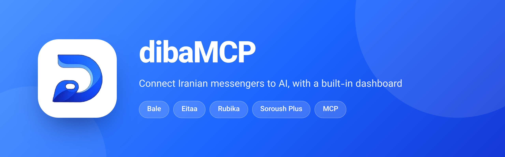
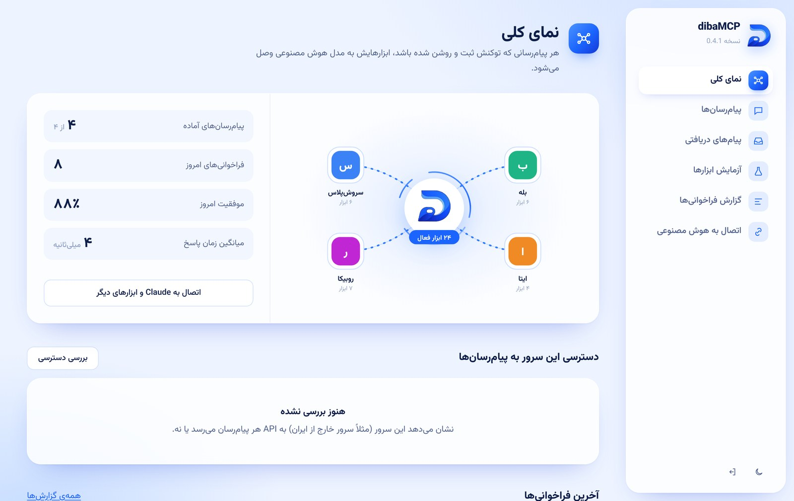
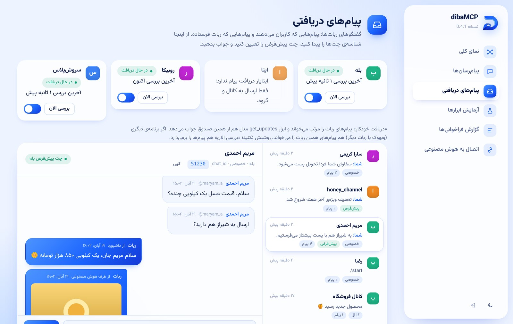
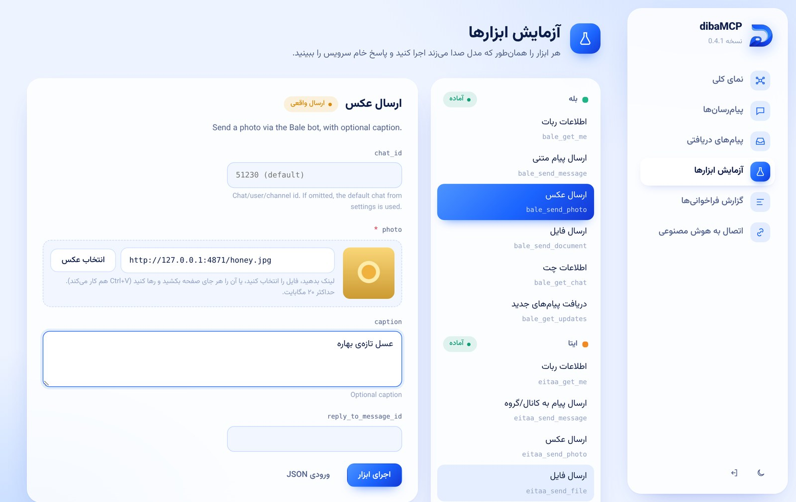
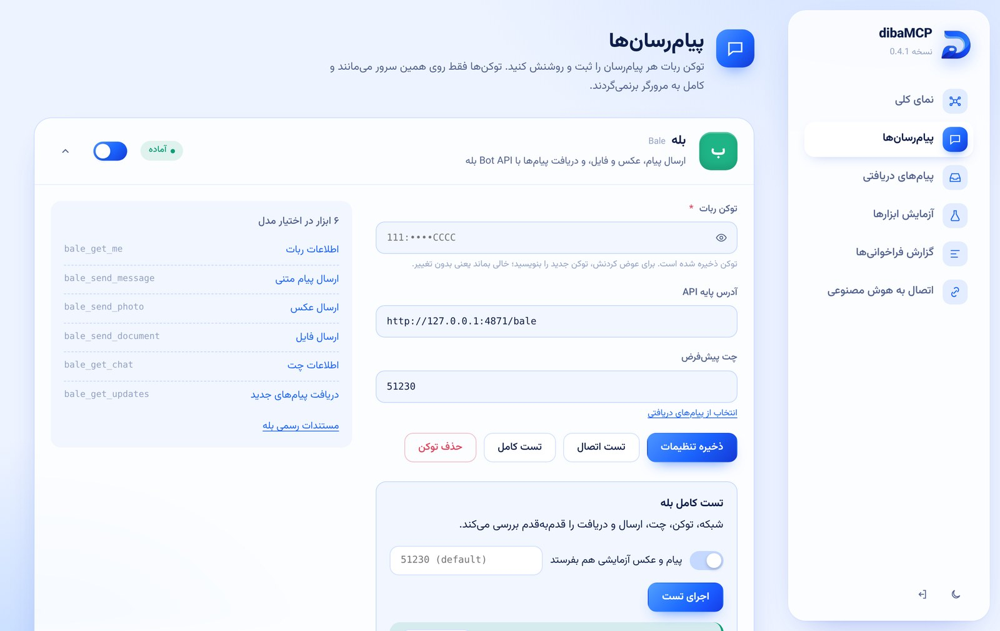
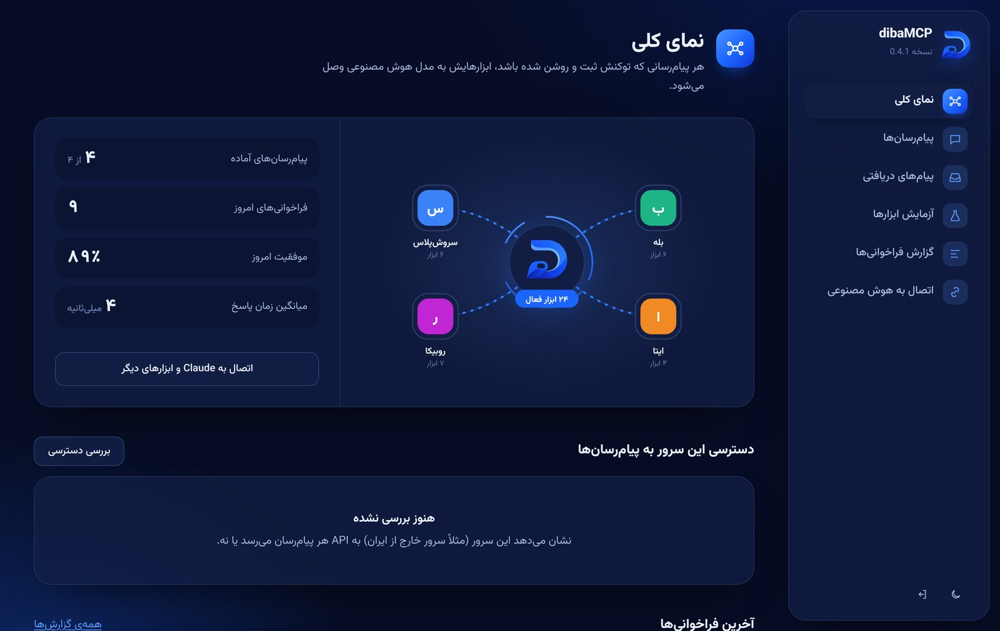

<p align="center">
  
</p>

<p align="center">
  <a href="https://github.com/yunessfa/diba-MCP/releases"></a>
  <a href="https://github.com/yunessfa/diba-MCP/actions/workflows/ci.yml"></a>
  
  
  <a href="LICENSE"></a>
</p>

<p align="center">
  <b>English</b> · <a href="README.fa.md">فارسی</a>
</p>

<br>

**dibaMCP** is a [Model Context Protocol](https://modelcontextprotocol.io) server that lets Claude, Cursor and any other MCP client send and read messages on Iranian messengers. It ships with a Persian dashboard for managing bots, testing tools and following conversations.

<p align="center">
  
</p>

## Features

| | |
|---|---|
| **Four messengers** | Bale, Eitaa, Rubika and Soroush Plus: text, photos, files and location |
| **Inbox** | Incoming and outgoing messages per chat, one-click `chat_id`, quick reply |
| **Media from anywhere** | Send by link, by `file_id`, or drop a file into the dashboard |
| **Full self-test** | Network, token, chat, send and receive checked step by step, with hints for each failure |
| **Runs outside Iran** | SOCKS5 / HTTP proxy support and a reachability check for every API |
| **Two transports** | Streamable HTTP for remote clients, stdio for Claude Desktop |
| **Safe by default** | Hashed admin password, signed sessions, rate limits, tokens never leave the server |
| **Embeddable** | Mount it as an Express router inside your own app |

## Quick start

Requires Node.js 22.19 or newer.

```bash
npm i -g https://github.com/yunessfa/diba-MCP/releases/download/v0.5.0/diba-mcp-0.5.0.tgz
diba-mcp
```

Open **http://127.0.0.1:3790**. On first run a six-character setup code is printed in the terminal; use it to create the dashboard password. Then add your bot tokens under *Messengers* and copy the MCP endpoint from *Connect*.

<details>
<summary><b>Docker</b></summary>

```bash
docker run -d --name diba-mcp -p 127.0.0.1:3790:3790 \
  -e ADMIN_PASSWORD=change-me \
  -v diba-mcp-data:/app/data \
  ghcr.io/yunessfa/diba-mcp:latest
```

A `docker-compose.yml` with optional HTTPS (Caddy) is included. See [DEPLOY.md](DEPLOY.md).
</details>

<details>
<summary><b>From source</b></summary>

```bash
git clone https://github.com/yunessfa/diba-MCP.git
cd diba-MCP
npm ci
cp .env.example .env
npm run dev
```
</details>

## Connect an AI client

**Claude Code**

```bash
claude mcp add --transport http diba-mcp http://127.0.0.1:3790/mcp \
  --header "Authorization: Bearer <MCP_TOKEN>"
```

**Cursor and other JSON-configured clients**

```json
{
  "mcpServers": {
    "diba-mcp": {
      "url": "http://127.0.0.1:3790/mcp",
      "headers": { "Authorization": "Bearer <MCP_TOKEN>" }
    }
  }
}
```

**Claude Desktop (stdio)**

```json
{ "mcpServers": { "diba-mcp": { "command": "diba-mcp", "args": ["stdio"] } } }
```

The token is shown on the *Connect* page, or run `diba-mcp token`.

## Screenshots

| Inbox | Tool playground |
|---|---|
|  |  |
| **Messengers and self-test** | **Dark theme** |
|  |  |

## Tools

| Messenger | Tools |
|---|---|
| Bale | `bale_get_me` `bale_send_message` `bale_send_photo` `bale_send_document` `bale_get_chat` `bale_get_updates` |
| Soroush Plus | `soroush_get_me` `soroush_send_message` `soroush_send_photo` `soroush_send_document` `soroush_get_chat` `soroush_get_updates` |
| Eitaa | `eitaa_get_me` `eitaa_send_message` `eitaa_send_photo` `eitaa_send_file` |
| Rubika | `rubika_get_me` `rubika_send_message` `rubika_send_photo` `rubika_send_file` `rubika_send_location` `rubika_get_chat` `rubika_get_updates` |
| All | `list_services` `list_chats` |

Set a default chat for a messenger and `chat_id` becomes optional. Eitaa (through Eitaayar) can only post to channels and groups and cannot receive messages.

## CLI

| Command | Description |
|---|---|
| `diba-mcp` | Start the dashboard and the MCP endpoint |
| `diba-mcp stdio` | Run over stdio |
| `diba-mcp selftest [id] [--send] [--chat <id>]` | Run the full self-test |
| `diba-mcp netcheck` | Check whether this machine can reach each messenger API |
| `diba-mcp token` | Print the MCP token |
| `diba-mcp reset-password` | Clear the dashboard password |

Options: `--port`, `--host`, `--data <dir>` (default `~/.diba-mcp`), `--env <file>`.

## Configuration

Everything can be set from the dashboard. Environment variables take priority and lock the matching field.

| Variable | Default | Description |
|---|---|---|
| `ADMIN_PASSWORD` | | Dashboard password (otherwise created with the setup code) |
| `MCP_TOKEN` | generated | Bearer token for MCP clients |
| `PORT` / `HOST` | `3790` / `127.0.0.1` | Listen address |
| `DATA_DIR` | `./data` | Config, logs and inbox |
| `SOCKS_PROXY` / `HTTPS_PROXY` | | Route messenger traffic through a proxy |
| `<ID>_TOKEN`, `<ID>_ENABLED`, `<ID>_RECEIVE`, `<ID>_DEFAULT_CHAT_ID` | | Per messenger: `BALE`, `EITAA`, `RUBIKA`, `SOROUSH` |
| `MCP_RATE_LIMIT` | `120` | Requests per minute to `/mcp`, per IP |
| `MCP_WRITE_LIMIT` | `30` | Send-type tool calls per minute from the model |
| `LOG_RETENTION_DAYS` | `14` | Days of call logs to keep |
| `ALLOW_PRIVATE_MEDIA_URLS` | `false` | Allow media downloads from internal addresses |

## Use as a library

```js
import express from "express";
import { createDibaMcp } from "diba-mcp";

const app = express();
const diba = createDibaMcp({ dataDir: "./data/diba" });

app.use("/diba", diba.router());

await diba.engine.callTool("bale_send_message", { text: "New order received" }, "dashboard");
```

Adding a messenger or any other service is one file in `src/providers/` that exports a `ProviderDef`; the settings form, playground and MCP tools are generated from it.

## Development

```bash
npm run dev          # watch mode
npm test             # unit + end-to-end tests
npm run typecheck
npm run build
```

```
src/
├─ core/        engine, config store, inbox, media, network, auth, self-test
├─ providers/   bale, eitaa, rubika, soroush
├─ http/        Express router: /mcp, /api, dashboard
├─ cli.ts       diba-mcp command
└─ index.ts     library entry
public/         dashboard (plain HTML, CSS and JS, no build step)
test/           unit tests and an end-to-end test with a real MCP client
```

## Roadmap

- [x] Messengers: text, media, inbox, self-test
- [ ] Buttons and a bot menu builder
- [ ] SMS: Kavenegar, SMS.ir
- [ ] Payments: Zarinpal, IDPay
- [ ] Offline tools: national ID, Sheba, Jalali dates

## License

[MIT](LICENSE)
